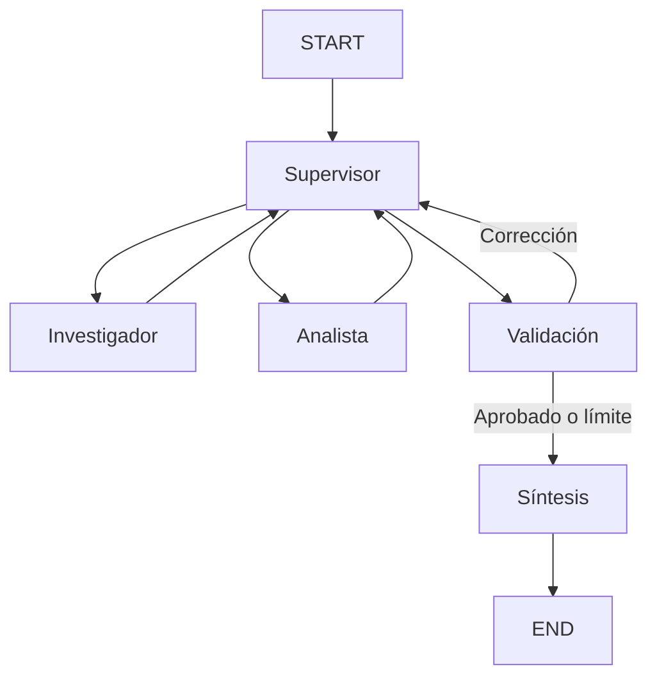

# entrega-6-orquestador
Orquestador multi-agente especializado

# Pre-entrega 6: Orquestador Multi-Agente

## Descripción

Prototipo funcional de un sistema multiagente desarrollado
con Python, LangGraph y OpenAI.

El sistema investiga pedidos comerciales, realiza cálculos
sobre los datos obtenidos y genera una respuesta final.

## Arquitectura

Se utiliza una topología jerárquica con un Supervisor
que decide dinámicamente qué especialista debe intervenir.


### Justificación de la topología

Se eligió una arquitectura jerárquica porque permite centralizar las decisiones en un Supervisor, mientras cada agente se especializa en una tarea concreta. Esto facilita la coordinación entre investigación y análisis, mantiene el contexto compartido y permite solicitar correcciones antes de generar la respuesta final.

### Componentes

- **Supervisor:** decide qué agente debe intervenir según
  la solicitud y las contribuciones disponibles.
- **Investigador:** consulta los pedidos mediante
  `buscar_pedidos`.
- **Analista:** calcula totales y promedios mediante
  `analizar_pedidos`.
- **Validación:** comprueba que ambos especialistas
  hayan ejecutado sus herramientas.
- **Síntesis:** redacta la respuesta final utilizando
  las contribuciones de los agentes.

## Estado compartido

El archivo `state.py` define `AgentState`, que hereda
de `MessagesState`.

Incluye el historial de mensajes, el próximo agente,
las contribuciones acumuladas, un contador de pasos
y los indicadores de finalización y validación.

## Manejo de conflictos

El Supervisor revisa las contribuciones de los agentes
antes de decidir el siguiente paso.

Si la validación detecta que falta una herramienta
obligatoria, el flujo vuelve al Supervisor para
solicitar una nueva intervención.

El sistema limita las intervenciones para evitar
bucles infinitos. Si alcanza el límite sin completar
la validación, informa que el análisis no pudo
finalizarse correctamente.

## Instalación

Requiere Python y una clave de OpenAI con créditos API.

1. Clonar el repositorio.
2. Instalar dependencias:

   ```bash
   python -m pip install -r requirements.txt
   ```

3. Copiar `.env.example` a `.env`.
4. Configurar `OPENAI_API_KEY` en `.env`.

## Ejecución

```bash
python main.py
```

## Pruebas

```bash
python -m pytest tests/ -v
```

Las pruebas verifican el recorrido del grafo mediante
especialistas simulados y el funcionamiento de las
herramientas reales sobre los pedidos de ejemplo.

## Ejemplo de consulta

"Investigá los pedidos de los clientes 102 y 205.
Calculá cuánto gastó cada uno y determiná quién
realizó compras por un importe mayor y cuál es
la diferencia."

Resultados esperados:

- Cliente 102: $14.500.
- Cliente 205: $11.000.
- Diferencia: $3.500.

## Limitaciones

La validación actual comprueba la ejecución registrada
de las herramientas, pero todavía no verifica
independientemente la exactitud de todos los cálculos.

El funcionamiento con OpenAI requiere créditos
disponibles en la cuenta de API.
